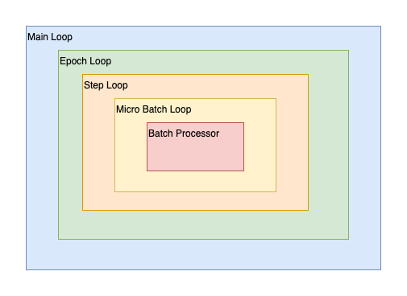
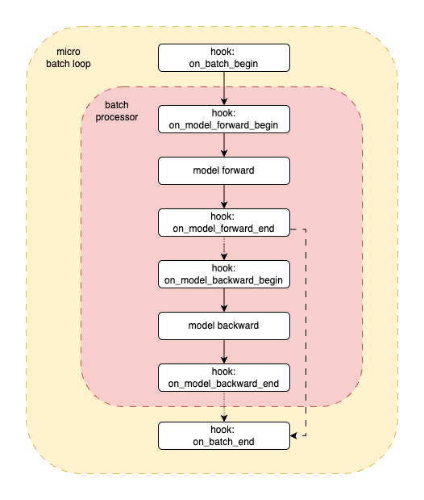

.. _overview_hook_based_trainer_arch:

Hook Based Trainer Architecture
==========================================

The :py:class:`~robo_orchard_lab.pipeline.hook_based_trainer.HookBasedTrainer` is the heart of RoboOrchardLab,
orchestrating the training and evaluation processes through a structured and extensible pipeline.
This pipeline is characterized by nested execution loops and numerous hook channels, allowing for precise customization at various stages.

Visualizing the Execution Flow
------------------------------

To effectively leverage the hook system, it's crucial to understand
the pipeline's execution flow. The following diagrams illustrate this structure,
starting with a high-level view of the nested loops and then detailing the operations
within a single micro-batch.

1. Nested Execution Loops
^^^^^^^^^^^^^^^^^^^^^^^^^^^^^^^

The core pipeline operates as a series of clearly defined, nested loops, each associated with specific hook channels:

   High-level view of the nested execution loops: Main Loop, Epoch Loop, Step Loop, and Micro Batch Loop with the Batch Processor at its core.

* **Main Loop (on_loop_* hooks)**: This is the outermost context,
  encompassing the entire run (e.g., a full training session or an evaluation pass).
  ``on_loop_begin`` is for global setup, and ``on_loop_end`` is for final cleanup and reporting.
* **Epoch Loop (on_epoch_* hooks)**: Iterates over the specified number of epochs.
  ``on_epoch_begin`` allows for epoch-specific initializations (e.g., resetting metrics),
  while ``on_epoch_end`` is typically used for validation, learning rate adjustments,
  and epoch-level checkpointing/logging.
* **Step Loop (on_step_* hooks)**: Represents one dataloader step, also referred to as a micro step when gradient accumulation is used.
  ``on_step_begin`` precedes processing for the current micro-batch, and ``on_step_end`` follows that micro-batch's forward/backward work.
* **Optimizer Step Scope (on_optimizer_step hooks)**: Wraps optimizer-step finalization on gradient-synchronization boundaries.
  ``on_optimizer_step`` is entered only when the trainer is ready to finalize an optimizer step.
  Its after-hooks can inspect ``PipelineHookArgs.is_optimizer_step_committed`` to distinguish committed updates from skipped boundaries, such as overflow skips.
* **Micro Batch Loop (on_batch_* hooks)**: This is the innermost data processing loop,
  handling one micro-batch at a time as provided by the DataLoader. The **Batch Processor** component executes its core logic within this loop.

2. Detailed Micro Batch Processing and Hook Activation
^^^^^^^^^^^^^^^^^^^^^^^^^^^^^^^^^^^^^^^^^^^^^^^^^^^^^^^^^^^^^^

The diagram below details the operations and hook activations *within* a single iteration of the "Micro Batch Loop," as orchestrated by the **Batch Processor**:

   Detailed flow for processing a single micro-batch, highlighting model execution stages and their corresponding hook points.

This detailed flow for a micro-batch proceeds as follows:

* **hook: on_batch_begin**: Triggered before any processing of the current micro-batch.
* **hook: on_model_forward_begin**: Called immediately before the model's forward pass.
* **model forward**: The Batch Processor executes the model's forward pass using the current micro-batch, typically computing outputs and loss.
* **hook: on_model_forward_end**: Called immediately after the forward pass. Model outputs are available in ``PipelineHookArgs`` at this point. A model may explicitly publish loss entries in those outputs, which makes the event suitable for metric updates.
* *(Conditional Backward Pass - see "Training and Evaluation Modes" below)*
* **hook: on_model_backward_begin**: Called just before initiating the backward pass (gradient computation).
* **model backward**: The Batch Processor executes the backward pass (e.g., ``accelerator.backward(loss)``).
* **hook: on_model_backward_end**: Called immediately after the backward pass. Gradients are now available.
* **hook: on_batch_end**: Triggered after all operations for the current micro-batch (including forward and potential backward passes) are complete.

Core Operations
------------------------------------
The **Batch Processor** is responsible for the ``model forward`` and ``model backward`` stages. The ``HookBasedTrainer``,
in conjunction with **Hugging Face ``Accelerator``**, manages higher-level operations such as:

* Moving data and models to the correct device.
* Wrapping the model, optimizer, and dataloader for distributed training.
* Handling gradient accumulation (``on_step`` tracks each micro-batch, and ``Accelerator`` determines when to sync gradients and step the optimizer).
  By default, Accelerate completes a short window at the end of an epoch.
  With ``sync_with_dataloader=False``, windows can span epochs, and a final
  unfinished window is not applied when training ends.
* Performing ``optimizer.step()`` and ``optimizer.zero_grad()`` inside the ``on_optimizer_step`` hook context on optimizer-step boundaries.
* Calling ``lr_scheduler.step()`` during training without a validation metric.
  Metric-based schedulers such as ``ReduceLROnPlateau`` are not supported by
  this trainer. DeepSpeed-owned schedulers follow the engine configuration.
  A DeepSpeed scheduler factory is resolved by the engine, so the trainer's
  early validation does not inspect its result.
  With DeepSpeed, the engine may perform the optimizer step during backward; the trainer observes the committed progress and reports it through ``on_optimizer_step`` instead of owning the low-level step call.

Role of ``PipelineHookArgs``
--------------------------------------------------------
At every hook trigger point (i.e., within the ``on_enter`` and ``on_exit`` methods of a ``HookContext`` registered to a channel),
an instance of ``PipelineHookArgs`` is passed. This object provides rich contextual information about the current state of the pipeline,
including epoch/step IDs, the current micro-batch data, model outputs, and references to the ``accelerator``, ``optimizer``, etc.
This allows hooks to make informed decisions and perform relevant actions.

**Backward-loss migration.** ``PipelineHookArgs`` does not publish the tensor passed to backward. The
deprecated ``reduced_backward_loss`` constructor input remains only so old
hook factories can construct the context; its value is discarded. Reading
either ``reduced_backward_loss`` or the retired ``reduce_loss`` alias raises
``RuntimeError`` even after compatible construction. This is deliberately a
fail-closed migration, not a loss-value compatibility layer. A hook that
needs a reportable loss must read a loss entry that the model explicitly
places in ``model_outputs``. That entry is the supported hook contract; it is
not assumed to be the tensor used for backward.

**Loss aggregation.** ``LossTracker`` accumulates detached local sum/count
pairs from every micro-step and performs one packed ``sum`` reduction only at
the completed accumulation-window logging boundary, including AMP skips. With
``accumulate_grad_steps=1`` this is numerically equivalent to the former
per-update mean reduction; the delayed boundary is intentional so multi-step
accumulation and uncommitted optimizer steps are handled correctly. A logging
window infers its complete loss-key set from the first update. Every later
update in that window must publish exactly the same set on every rank; the
tracker does not synchronize key presence or fill missing keys. A completed
logging boundary or an exception clears the window,
so the next window may establish a different key set. The old two-argument
``LossTracker.update(accelerator, model_outputs)`` call shape remains accepted,
but the accelerator is ignored and the retired mutable cache fields are not a
supported extension point. A custom ``update`` override must delegate to
``super().update`` to contribute to the canonical aggregation; arbitrary
override-owned state is not reconstructed.

Trainer checkpoints do not persist ``LossTracker`` or ``MetricTracker``
aggregation state. A logging or reset interval crossing a restart may report
only post-resume updates until the next reset. The trainer warns on resume;
metric names and logging boundaries remain unchanged.

**Checkpoint persistence.** For supported trainer/data recovery configurations,
at a completed optimizer-step boundary the trainer records its processed batch
progress and data recovery information for each rank. It delegates file
saving and retention to Accelerate. It does not restore unfinished gradient
accumulation. There is no directory-level atomic publication or rollback: an
interrupted save may leave partial files, and automatic retention may delete
older checkpoints before a new save finishes. Accelerate loads training state
and global RNG; data recovery uses the saved position. When resuming within an
epoch, the prepared iteration adapter preserves the post-load training RNG across data skipping;
random behavior in custom hooks and transforms is not guaranteed to replay.
For supported recovery configurations, if a checkpoint lacks a current
DataLoader snapshot, the trainer warns and replays the consumed epoch prefix.
Its data order and position may differ. An unfinished accumulation window in a
native checkpoint is restarted with a warning; its uncheckpointed gradients
are not recovered. Trainer/data recovery excludes DeepSpeed/FSDP, node-local
checkpoints, and external stateful loaders; native saving remains available.
Recovery capability is checked at every save. If a temporary limitation
is removed, later saves can capture data recovery state again; an earlier
native-only save does not permanently downgrade the running trainer.
``ResumeCheckpointConfig.load_state`` applies Lab training recovery checks
and resets a registered trainer's accumulation phase after native loading
finishes. The generic ``utils.huggingface.accelerator_load_state`` only handles
local/remote loading and staging cleanup: it delegates registered custom
objects to Accelerate and preserves the native loaded phase. Registering
``TrainerProgressState`` alone does not enable training policy in that helper.
Once training, a hook or saving raises an error, checkpoint behavior is
undefined. There is no cross-rank checkpoint error-coordination guarantee; the
trainer attempts its normal DataLoader cleanup.

Prepared Data in Custom Training Loops
----------------------------------------------------------

``utils.accelerate.prepare_data_loader`` prepares a loader once and binds its
sampling and recovery owners. Use ``iterate_prepared_loader`` to manage an
epoch in a handwritten loop; ``HookBasedTrainer`` uses the same boundary.
The context owns epoch binding, staged data recovery, first-fetch RNG
restoration, read-failure/EOF coordination and iterator cleanup. All ranks
must follow the same fetch and post-batch stop-check sequence. Notification
cannot release a peer blocked outside those checks.

.. code-block:: python

    from robo_orchard_lab.utils.accelerate import (
        iterate_prepared_loader,
        prepare_data_loader,
    )

    loader = prepare_data_loader(accelerator, loader)
    model, optimizer = accelerator.prepare(model, optimizer)
    for epoch in range(num_epochs):
        with iterate_prepared_loader(accelerator, loader, epoch=epoch) as batches:
            for batch in batches:
                with accelerator.accumulate(model):
                    loss = compute_loss(model, batch)
                    accelerator.backward(loss)
                    optimizer.step()
                    optimizer.zero_grad()
                    if accelerator.sync_gradients:
                        batches.commit()
                if batches.should_stop(local_stop=reached_training_limit()):
                    break
            else:
                continue
            break

``commit()`` latches the processed Lab data position at a completed optimizer
window, including AMP-skipped updates. Call it before checkpoint hooks run.
The loop owns model updates, scheduler calls, hooks, progress counters and
checkpoint persistence; this context does not save training state. On normal
EOF, persistent workers may remain available for the next epoch. Early exit
and errors close the active iteration through the existing loader lifecycle.

Training and Evaluation Modes
----------------------------------------------------------
The pipeline structure illustrated is versatile:

* **Training Mode**: The ``model backward`` operation and its associated hooks (``on_model_backward_begin``, ``on_model_backward_end``) are executed. The ``BatchProcessor`` is typically configured with ``need_backward=True``.
* **Evaluation Mode**: The ``model backward`` operation and its hooks are skipped. This is achieved by configuring the ``BatchProcessor`` appropriately (e.g., ``need_backward=False``) or by the trainer using a different execution path for evaluation steps.
  The ``on_batch_end`` hook remains crucial for calculating evaluation metrics. An evaluation phase is often triggered via the ``on_epoch_end`` hook.

Extensibility through Hooks
------------------------------------------------------
This detailed, hook-rich pipeline architecture provides numerous well-defined points for injecting custom logic.
Users can develop and register hooks to implement a wide array of functionalities—such as custom metric logging,
advanced checkpointing strategies, dynamic parameter adjustments, early stopping, and interaction with external
systems—without needing to modify the core ``HookBasedTrainer`` or ``BatchProcessor`` code.
This makes RoboOrchardLab highly adaptable and powerful for diverse research and development needs in embodied AI.
